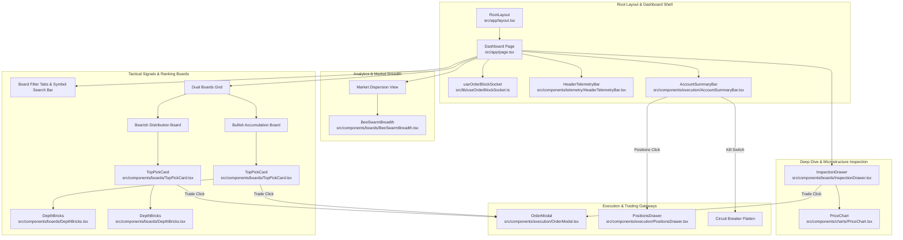
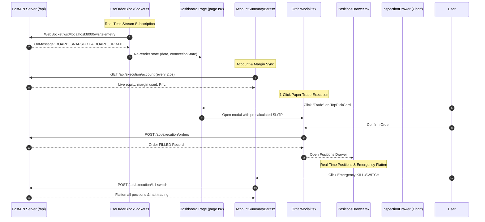

# Frontend Graph Context & Architecture

This document describes the component hierarchy, UI state flow, real-time WebSocket consumption, and charting pipeline of the Next.js client for the **OrderBlock Market Scanner & Intelligence Engine**.

---

## 1. High-Level Component Hierarchy

---

## 2. Frontend State & Telemetry Flow

---

## 3. Component Details & Responsibilities

| Component | Path | Data Inputs (Props) | Output / User Interactions |
| :--- | :--- | :--- | :--- |
| **Dashboard Page** | `src/app/page.tsx` | None (Top-level client container) | Manages tabs, search queries, selected symbol, modal states. |
| **useOrderBlockSocket** | `src/lib/useOrderBlockSocket.ts` | `wsUrl`, `fallbackPollUrl` | Custom hook with auto-reconnect backoff and HTTP fallback. |
| **HeaderTelemetryBar** | `src/components/telemetry/HeaderTelemetryBar.tsx` | `wsStatus`, `syncQuality`, `universeSize` | Displays connection badge, Upstox token health, and sync quality. |
| **AccountSummaryBar** | `src/components/execution/AccountSummaryBar.tsx` | `onOpenPositions`, `onKillSwitchTriggered` | Live equity, margin used, daily loss ticker, and emergency Kill-Switch. |
| **OrderModal** | `src/components/execution/OrderModal.tsx` | `pick`, `isOpen`, `onClose`, `onOrderSuccess` | 1-click paper trading dialog with ATR Stop Loss & Target. |
| **PositionsDrawer** | `src/components/execution/PositionsDrawer.tsx` | `isOpen`, `onClose` | Slide-over drawer of open positions and order audit log with close actions. |
| **BeeSwarmBreadth** | `src/components/boards/BeeSwarmBreadth.tsx` | `dots`, `bullishCount`, `bearishCount`, `onSelect` | SVG breadth dispersion with Lucide icons. |
| **TopPickCard** | `src/components/boards/TopPickCard.tsx` | `pick`, `onInspect`, `onTrade`, `tier` | Hero card with setup metrics, depth bricks, and trade trigger. |
| **InspectionDrawer** | `src/components/boards/InspectionDrawer.tsx` | `pick`, `candles`, `isOpen`, `onClose`, `onTrade` | 9-metric institutional breakdown and embedded 5m `PriceChart`. |
