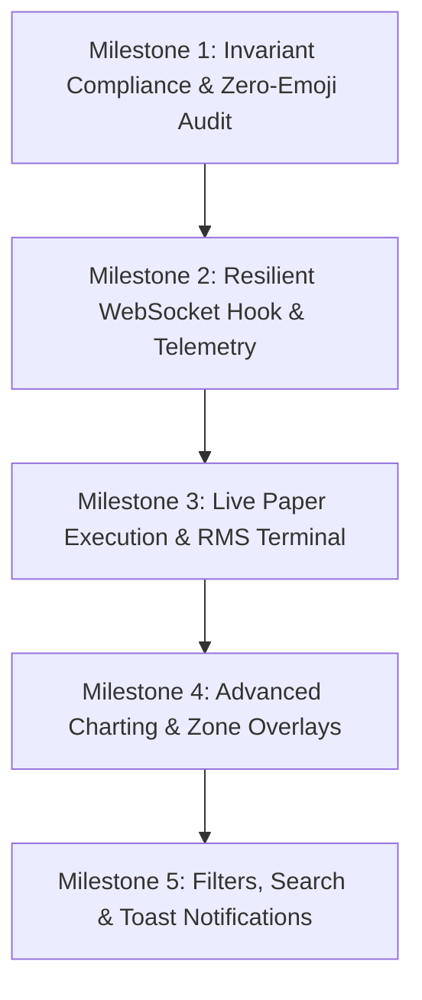

# Frontend Task List & Implementation Plan: Production Live Terminal

This document establishes the structured roadmap, milestone deliverables, and actionable task list for upgrading the **OrderBlock Next.js 15+ App Router Frontend** into a production-grade, real-time trading and market intelligence terminal.

All tasks strictly enforce the invariants defined in [`docs/FE_rulebook.md`](file:///home/kaif/storage/MyProjects/order-block/docs/FE_rulebook.md).

---

---

## Milestone 1: Rulebook Compliance, Design Tokens & Zero-Emoji Cleanup

### Objectives
1. Eliminate all raw system/OS emojis across buttons, headers, cards, and tables in strict compliance with Section 2.1 of [`docs/FE_rulebook.md`](file:///home/kaif/storage/MyProjects/order-block/docs/FE_rulebook.md).
2. Standardize styling with Lucide React vector icons wrapped in duotone container pills.
3. Add tactile feedback (`active:scale-[0.98] transition-transform duration-100`) and ensure minimum 48–56px tap targets.

### Target Files
- `frontend/src/app/page.tsx`
- `frontend/src/components/boards/TopPickCard.tsx`
- `frontend/src/components/boards/BeeSwarmBreadth.tsx`
- `frontend/src/components/boards/InspectionDrawer.tsx`
- `frontend/src/app/globals.css`

### Actionable Tasks
- [ ] Replace all Unicode arrows and emojis (`▲`, `▼`, `↗`, `↘`, `🔥`, etc.) with Lucide React icons (`TrendingUp`, `TrendingDown`, `ArrowUpRight`, `ArrowDownRight`, `Flame`, `ShieldAlert`, `Activity`, `CheckCircle2`).
- [ ] Implement tactile feedback CSS utilities on all interactive cards, tab triggers, and buttons.
- [ ] Enforce stable keys (`key={stock.symbol}`) across all mapping iterators (no `key={index}`).
- [ ] Verify zero `any` types across all component prop interfaces.

---

## Milestone 2: Resilient WebSocket Hook & Telemetry Sync

### Objectives
1. Replace ad-hoc `useEffect` WebSocket with a dedicated, custom React hook (`useOrderBlockSocket`).
2. Implement exponential backoff auto-reconnection: $\min(1000 \times 2^{\text{attempt}}, 10000)$ ms.
3. Add ambient telemetry warnings for feed latency, stale snapshots (>60s), and broker auth health.

### Target Files
- `frontend/src/lib/useOrderBlockSocket.ts` *(New)*: Auto-reconnecting WebSocket client with heartbeat.
- `frontend/src/components/telemetry/HeaderTelemetryBar.tsx` *(New)*: Telemetry status badge, latency gauge, and broker token health indicator.
- `frontend/src/app/page.tsx`: Integrate hook and telemetry bar.

### Actionable Tasks
- [ ] Create `useOrderBlockSocket(url)` handling connection state (`CONNECTING`, `LIVE`, `STALE`, `DISCONNECTED`).
- [ ] Implement fallback to HTTP polling `/api/boards` (every 3 seconds) whenever WebSocket is interrupted.
- [ ] Display broker token expiry counter and Upstox connection badge in the header.
- [ ] Add amber ambient banner when cycle quality drops to `DEGRADED` or timestamp skew exceeds 30 seconds.

---

## Milestone 3: Real-Time Paper Trading & RMS Execution Terminal

### Objectives
1. Integrate the new backend execution routes (`/api/execution/`) directly into the frontend.
2. Provide a 1-click order entry modal for Top Picks, auto-populating ATR-based Stop-Loss and Target.
3. Build account summary ticker and emergency **Kill-Switch** circuit breaker.

### Target Files
- `frontend/src/components/execution/AccountSummaryBar.tsx` *(New)*: Portfolio equity, available margin, daily PnL, open positions ticker.
- `frontend/src/components/execution/OrderModal.tsx` *(New)*: 1-click paper trading dialog with ATR quantity calculator and SL/TP preview.
- `frontend/src/components/execution/KillSwitchButton.tsx` *(New)*: Emergency kill switch with double-confirmation dialog and audio cue.
- `frontend/src/components/execution/PositionsDrawer.tsx` *(New)*: Slide-over active positions and open orders table with close-position action.

### Actionable Tasks
- [ ] Create `AccountSummaryBar` polling `/api/execution/account` every 2 seconds.
- [ ] Add "Trade Setup" action button on `TopPickCard` opening `OrderModal`.
- [ ] Wire `KillSwitchButton` to `POST /api/execution/kill-switch` to immediately flatten open positions.
- [ ] Add live mark-to-market PnL badge to active positions table.

---

## Milestone 4: Advanced Charting & Order Block Zone Overlays

### Objectives
1. Upgrade `PriceChart.tsx` to visualize structural SMC concepts accurately.
2. Shaded Order Block zones with distinct styles for `FRESH`, `MITIGATED`, and `INVALIDATED` states.
3. Highlight Liquidity Sweeps with dashed wick-piercing lines and Swing High/Low pivot labels.

### Target Files
- `frontend/src/components/charts/PriceChart.tsx`
- `frontend/src/lib/chartCoordinates.ts` *(New)*: Precision time-to-pixel and price-to-pixel coordinate projection math.

### Actionable Tasks
- [ ] Render rectangular Order Block zone bounding boxes directly over 5m candlesticks.
- [ ] Style `FRESH` zones with solid emerald/crimson borders and 15% opacity fills.
- [ ] Style `MITIGATED` zones with dashed borders and reduced 40% opacity.
- [ ] Render crosshair HUD showing OHLCV, zone distance, and Risk-to-Reward ratio upon hover.

---

## Milestone 5: Sector Filters, Universal Search & Toast Alerts

### Objectives
1. Add fast client-side symbol search (`Cmd + K` or `Ctrl + K` quick find).
2. Add sector categorization filters (Banks, IT, Auto, Pharma, FMCG, Energy, Metals).
3. Implement toast notifications for new Order Block formations and RMS circuit breaker events.

### Target Files
- `frontend/src/components/navigation/CommandSearch.tsx` *(New)*: Quick-find symbol modal.
- `frontend/src/components/navigation/SectorFilterTabs.tsx` *(New)*: Multi-sector filter bar.
- `frontend/src/components/ui/ToastNotification.tsx` *(New)*: Non-intrusive alert toasts.

### Actionable Tasks
- [ ] Implement `CommandSearch` fuzzy search matching against all 213 F&O symbols.
- [ ] Add sector filter chips to isolate specific sector movements.
- [ ] Add sound effect and toast alert when a new high-conviction Top Pick enters the board.

---

## Testing & Verification Plan

| Component / Layer | Verification Test | Success Criteria |
| :--- | :--- | :--- |
| **Lint & TypeScript** | `npm run lint` & `tsc --noEmit` | 0 errors, 0 warnings, zero `any` types. |
| **Zero Emoji Audit** | Grep repository for Unicode emoji glyphs | 0 occurrences in UI markup. |
| **WebSocket Reconnect** | Kill backend, wait 5s, restart backend | Frontend reconnects automatically without page refresh. |
| **Order Execution** | Place paper order from Top Pick card | Order filled, appears in active positions, equity updates. |
| **Kill-Switch Test** | Trigger kill switch button | All open positions closed, status reflects halted trading. |
| **Code Review Audit** | `invoke_subagent(name="code_reviewer")` | Full pass against `FE_rulebook.md`. |
